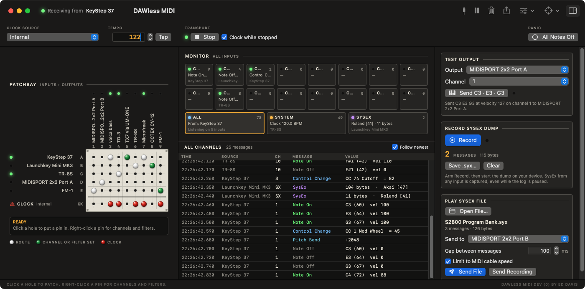

# DAWless MIDI

A macOS patchbay for playing hardware without a DAW: route any MIDI input to any MIDI output, choose exactly which devices receive MIDI clock, and watch everything that comes in. It also has MIDI Flicker's monitor, SysEx recorder and player, and test chord built in.



By Ed Davis. Copyright © 2026 Ed Davis.

## What it does

**Patchbay.** The routing is a pin matrix, laid out like the one on an EMS VCS3. Inputs run down the left, lettered A, B, C…, and outputs run across the top, numbered 1, 2, 3…, with their names turned on end. Click a hole to put a pin in and send that input to that output; click the pin to take it out. An input can go to any number of outputs, and an output can take any number of inputs, which are merged.

Hover over a hole and its row and column light up, and the readout under the board says what it connects and what the pin does.

There are three colours of pin, as on the VCS3:
- **White**: a route that passes everything unchanged.
- **Green**: a route with a channel or filter set.
- **Red**: clock, in the Clock row along the bottom.

**Channels and filters.** Right-click a pin to:
- listen to one channel only (or all)
- move everything to another channel (**Send On**)
- block notes, control changes, program changes, pitch bend, aftertouch or SysEx on that route

The pin turns green when any of these are set.

**Clock.** The red pins in the Clock row decide which outputs get clock. Clock comes from one place, chosen at the top of the window:
- **Internal** – the app's own clock, with BPM, tap tempo, Start, Stop and Continue. *Clock while stopped* (on by default) keeps clock running while stopped, so arpeggiators, LFOs and delays stay in time.
- **From an input** – follow a device's clock (a drum machine or sequencer, say) and pass its clock, start, stop, continue and song position to the ticked outputs. Its tempo is shown at the top.
- **Off** – no clock is sent.

Clock never goes through the routes, only through the Clock row. Clock from any input that isn't the chosen source is dropped, so you never end up with two clocks fighting.

The internal clock hands Core MIDI each tick ahead of time with an exact timestamp, so its timing doesn't depend on the app being in front or the Mac being busy.

**Activity lights.** Each input and output has a lamp that flashes on MIDI, so you can see what's arriving and where it's going.

**Monitor** (from MIDI Flicker). Every input is monitored all the time. There's a tile for each of the 16 channels, plus System (clock, start, stop; shows the tempo when clock is arriving), SysEx and All. Each tile has a lamp, a message count, the latest message decoded and the device it came from. Click a tile to show just that channel in the log.

The log lists messages as they arrive, with the time, the device, the channel, the message type in colour, its decoded value and the raw bytes. Click a row for the whole message and a hex dump, with **Copy Hex** and, for SysEx, **Save as .syx…**. **Follow newest** keeps the latest message in view.

In the toolbar: **Pause** freezes the log (counters, lamps and SysEx recording keep going), **Clear**, **Export Log** (a tab-separated text file), **Options** (hide clock and active sensing, which is on by default, and whether note 60 is C3 or C4), and **Focus Input** to monitor just one device. You can also right-click an input in the patchbay and choose **Monitor Only…**. The toolbar shows which device sent the latest message.

**MIDI Sources window.** Lists every input with its device, maker and model, a lamp, and what it has sent. Handy for finding out what a new device is called.

**SysEx and test panel** (from MIDI Flicker; hide or show it with the toolbar button on the right):
- **Test Output** plays a C major chord at full velocity for half a second on the output and channel you choose.
- **Record SysEx Dump** captures SysEx from any input, even while the log is paused. Save it as a .syx file.
- **Play SysEx File** sends a .syx file, or your recording, to an output, with a gap between messages and an option to limit the speed to what a 5-pin MIDI cable can carry, for older samplers and synths.

**Devices come and go.** Plug devices in and out freely. Routes to a device that isn't connected stay in the matrix (greyed out) and work again when it's plugged back in, even if macOS gives it a new ID. Right-click a greyed-out device to forget it.

**Runs in the background.** Close the window and routing carries on. The menu bar icon has Start/Stop, the tempo, All Notes Off and Quit.

**All Notes Off** sends sustain off, all sound off and all notes off on every channel of every output.

Your setup is saved as you go and restored when the app opens.

### Keyboard

| | |
|---|---|
| ⌘↩ | Start / Stop the internal clock |
| ⌘T | Tap tempo |
| ⌘= / ⌘- | Tempo up / down by 1 BPM |
| ⌘. | All Notes Off |
| ⌘O | Open a SysEx file to send |
| ⌘E | Export the log |
| ⇧⌘P | Pause or resume the log |
| ⌘K | Clear the log |
| ⌘0 | Show all channels |
| ⌘R | Start or stop recording SysEx |

## Building

Needs macOS 13 or later and Xcode 15 or later (Swift 5.9).

```sh
swift test            # routing, filter, clock and SysEx tests
./make-app.sh         # build/DAWless MIDI.app, ad-hoc signed
./make-dmg.sh         # a test DMG
./release.sh          # Developer ID signed and notarized DMG
```

Every push builds, tests, and keeps a test DMG as a workflow artifact. **Actions › Release › Run workflow** builds a signed, notarized DMG and publishes it as a GitHub release. It needs the secrets listed at the top of `.github/workflows/release.yml`.

## Layout

- `Sources/DAWlessCore` – the routing logic, with no Core MIDI in it: the MIDI stream parser, route filters, the saved setup and the clock and tempo maths. Tested in `Tests/DAWlessCoreTests`.
- `Sources/DAWlessMIDI` – the app: the Core MIDI engine, the internal clock thread, the monitor and the SwiftUI window and menu bar item. `Patchbay.swift` is the pin matrix and `Theme.swift` the panel colours, lamps and pins.

`DAWlessMIDI --screenshot <folder>` fills the window with made-up devices, saves a picture of it and quits. The Screenshot workflow does this on every push and commits the result to `docs/screenshots`.
